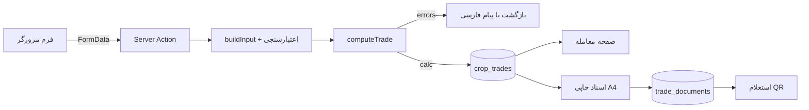

# معماری «معامله و تسویه محصول» — کشاورزحساب ۱.۰.۰

این سند معماری بخش جدید **معامله محصول** را توضیح می‌دهد: از محاسبه وزن و افت تا صدور اسناد رسمی قابل چاپ.
هدف اصلی، پاسخ به یک نیاز واقعی است:

> «گندمم ۲۵ تن است؛ به کارخانه می‌فروشم. با رطوبت ۱۵٫۵٪ و ناخالصی ۲٫۶٪، چقدر پول می‌گیرم و کدام سند را باید امضا کنم؟»

---

## ۱. اصول طراحی

1. **قطعیت محاسبه:** هیچ عددی به مدل زبانی یا تخمین سپرده نمی‌شود. موتور محاسبه یک تابع خالص (Pure) و قابل آزمون است.
2. **اتکای به سرور:** مرورگر فقط ورودی می‌فرستد؛ مبلغ نهایی در سرور با همان موتور محاسبه و ذخیره می‌شود. دستکاری فرم به مبلغ جعلی منجر نمی‌شود.
3. **تصویر لحظه امضا:** ورودی کامل و خروجی کامل محاسبه در ستون‌های `input` و `calc` (JSONB) ذخیره می‌شود تا سند چاپی بعدی، همان اعداد زمان ثبت را نشان دهد.
4. **تاریخ ایرانی:** همه تاریخ‌ها شمسی وارد، شمسی نمایش داده و در پایگاه داده ISO ذخیره می‌شوند. تبدیل‌ها در `src/lib/format.ts` با الگوریتم دقیق جلالی انجام می‌شود.
5. **شفافیت برای دو طرف:** خروجی شامل «ردّ حسابرسی» مرحله‌به‌مرحله وزن و پول است تا خریدار و فروشنده بتوانند روی برگه چاپی آن را بازبینی کنند.
6. **بدون وابستگی سنگین:** فقط `qrcode` برای QR اسناد افزوده شده است؛ بقیه محاسبات درون پروژه است.

---

## ۲. لایه‌بندی

```
src/lib/trade/engine.ts      موتور خالص: واحدها، کیفیت، درجه، افت، قیمت، مالیات، اعتبارسنجی، سریال
src/lib/trade/service.ts     دسترسی داده: فهرست، آمار، تولید شماره، ثبت پرداخت، صدور سند، استعلام
src/lib/trade/selftest.ts    آزمون‌های خودکار موتور (صفحه /diagnostics و /api/self-test)
src/app/trade/actions.ts      Server Actions: ثبت معامله، دریافت‌ها، تغییر وضعیت، حذف
src/app/trade/page.tsx        فهرست، آمار، راهنمای سریع و مبانی قانونی
src/app/trade/new/page.tsx    فرم ثبت با محاسبه لحظه‌ای (Client Component)
src/app/trade/[id]/page.tsx   صورت‌حساب، ردیابی تسویه، اسناد، تغییر وضعیت
src/app/trade/[id]/print/[doc] چاپ رسمی پنج سند + QR اصالت
src/app/verify/page.tsx       استعلام عمومی اصالت سند با سریال
src/components/TradeCalculator.tsx  فرم محاسبه‌گر (کلاینت، با موتور مشترک)
src/components/print/TradeDocument.tsx  قالب A4 اسناد رسمی
```

جریان داده:



---

## ۳. مدل داده

### `crop_trades`
هدر معامله: کد یکتا (`KH-{سال شمسی}-{شماره}`)، جهت (فروش/خرید)، مبنا (تضمینی/کارخانه/توافقی)، محصول و رقم، طرفین و کدهای هویتی، محل و تاریخ‌ها، وزن‌ها (کیلوگرم)، کیفیت (رطوبت/ناخالصی/شکسته/سن/هکتولیتر/پروتئین)، قیمت هر کیلو، درجه، مبلغ کل، پیش‌پرداخت، دریافت‌شده، وضعیت، شرایط، و **`input`/`calc` کامل** به‌همراه `engine_version`.

### `trade_payments`
دریافتی‌ها: مبلغ (تومان)، تاریخ شمسی، روش (نقدی/بانکی/چک/تهاتر)، شماره پیگیری و یادداشت. مانده همیشه از جمع این جدول بازمحاسبه می‌شود؛ نه از ورودی کاربر.

### `trade_documents`
اسناد صادرشده: نوع سند، سریال یکتا (`KH-1405-0001/INV`)، زمان صدور و تصویر JSON لحظه صدور. کلید یکتای سریال مانع صدور تکراری می‌شود؛ چاپ مجدد همان نسخه است.

### قواعد پولی
- همه مبالغ **تومان** و صحیح ذخیره می‌شوند (نمایش ریالی با `formatMoney`).
- همه وزن‌ها **کیلوگرم** ذخیره می‌شوند؛ واحدهای «تن» و «خروار» فقط ورودی/نمایشی‌اند.
- درصدها تا دو رقم و وزن‌ها تا سه رقم اعشار گرد می‌شوند.
- مبلغ نهایی به مضرب قابل تنظیم (پیش‌فرض ۱٬۰۰۰ تومان) گرد می‌شود.

---

## ۴. خط لوله محاسبه

1. **وزن خالص:** `gross − tare` (اگر باسکول وارد شود) وگرنه `quantity × factor(unit)`.
2. **درجه‌بندی:** با رویکرد «ضعیف‌ترین شاخص تعیین‌کننده است»:
   - رطوبت بیش از سقف پذیرش → رد؛ رطوبت بیشتر از پایه → سقف درجه ۲.
   - هکتولیتر: ≥۷۸ درجه ۱، ≥۷۵ درجه ۲، ≥۷۲ درجه ۳، کمتر از ۷۲ → رد.
   - ناخالصی >۱٪ سقف درجه ۲، >۱٫۵٪ سقف درجه ۳، بیش از سقف پذیرش → رد.
   - سن‌زدگی >۰٫۵٪ سقف درجه ۳، >۲٪ → رد. دانه شکسته >۶٪ → درجه ۳.
   - پروتئین <۱۰٪ → حداکثر درجه ۳. پروتئین فقط می‌تواند کاهش دهد، نه ارتقا.
3. **افت‌ها:**
   - افت مفید + غیرمفید (پیش‌فرض تضمینی ۳٪+۱٪).
   - افت رطوبت وزنی: `(M−M₀)/(100−M₀)×100` یا توافقی `(M−M₀)×step`.
   - ناخالصی مازاد، کسر وزنی یک‌به‌یک؛ افت شکسته اختیاری.
   - سقف ایمنی: مجموع کسورات بیش از ۴۰٪ وزن خالص پذیرفته نمی‌شود و هشدار می‌دهد.
4. **قیمت:** قیمت پایه × ضریب درجه (اختیاری) + حق بیمه هر کیلو.
5. **پول:** ارزش محصول = وزن تعدیل‌شده × قیمت مؤثر؛ سپس کارمزد، کرایه/تخلیه (بر اساس مسئول پرداخت)، هزینه باسکول/نمونه‌برداری، مالیات (پیش‌فرض معاف)، خسارت تأخیر (سقف ۲۰٪ ارزش) و تعدیل توافقی.
6. **مانده:** `total − prepaid`؛ هیچ‌گاه منفی نمی‌شود و دریافت بیش از مانده در سرور رد می‌شود.
7. **خروجی:** `errors` (مانع ثبت)، `warnings` (هشدار هوشمند)، `steps` (ردّ حسابرسی)، `confidence` (کامل بودن داده‌ها) و `statusLabel`.

---

## ۵. اعتبارسنجی و ایمنی

- نام فروشنده و خریدار الزامی است؛ تاریخ قرارداد باید شمسی معتبر باشد.
- وزن خالص نامثبت، وزن خالی ≥ وزن پر، قیمت صفر و رطوبت/ناخالصی خارج از سقف، مانع ثبت می‌شوند.
- دریافت بیش از مانده، دریافت روی معامله لغو‌شده و تسویه بدون دریافت کامل رد می‌شود.
- ثبت معامله، دریافت، وضعیت و حذف، همگی Server Action با اعتبارسنجی دوباره هستند.
- تاریخ‌های نامعتبر شمسی (مثل ۱۴۰۴/۱۳/۰۱ یا ۳۰ اسفند سال غیرکبیسه) پذیرفته نمی‌شوند.
- استعلام عمومی، شماره هویتی را پوشیده نشان می‌دهد و فقط خلاصه سند را برمی‌گرداند.

---

## ۶. اسناد و چاپ اداری

| سند | کاربرد | اجزای کلیدی |
|---|---|---|
| قرارداد فروش | امضای توافق | طرفین، مقدار، کیفیت، قیمت، تعهدات، خسارت تأخیر، سه محل امضا |
| قبض باسکول | اثبات تحویل | وزن پر/خالی/خالص/تعدیل‌شده، پلاک، راننده، تحویل‌گیرنده |
| صورتجلسه کیفیت | اثبات درجه | شاخص‌ها، حد مجاز، وضعیت، درجه و امتیاز، حق اعتراض |
| فاکتور فروش | سند مالی | اقلام، وزن، نرخ، کسورات، مالیات، مبلغ به حروف |
| برگه تسویه | بستن حساب | ریز دریافتی‌ها، مانده، تعهد پرداخت |

- قالب A4 با `@page`، سرصفحه هویتی، جدول‌های خط‌کشی‌شده، مبلغ به حروف فارسی، سه محل مهر و امضا و پاصفحه با QR.
- QR به `/verify?serial=…` وصل است و اصالت سند را از پایگاه داده بررسی می‌کند.
- چاپ از پنجره مرورگر (Save as PDF) انجام می‌شود؛ رابط کاربری با `print:hidden` پنهان می‌شود.
- هر سند در اولین بازدید شماره سریال می‌گیرد و در `trade_documents` ثبت می‌شود.

---

## ۷. مبانی قانونی و تجاری

- **رطوبت:** حداکثر ۱۴٪ در تحویل گندم به مراکز خرید تضمینی.
- **افت استاندارد:** ۳٪ افت مفید و ۱٪ افت غیرمفید در خرید تضمینی.
- **ناخالصی:** حد مجاز معمول ۲٪؛ مازاد به‌صورت وزنی کسر می‌شود.
- **درجه‌بندی گندم:** وزن هکتولیتر، رطوبت، ناخالصی، شکسته، سن‌زدگی و پروتئین.
- **مالیات بر ارزش افزوده:** بند (الف) ماده ۹ قانون مالیات بر ارزش افزوده ۱۴۰۰ — محصولات کشاورزی فرآوری‌نشده معاف؛ نرخ پیش‌فرض صفر.
- **اعتبار قرارداد خصوصی:** ماده ۱۰ قانون مدنی؛ برای معاملات دولتی، فرم‌های ابلاغی و مهر رسمی لازم است.
- **نرخ‌ها:** اعداد پیش‌فرض قابل ویرایش‌اند و باید با آخرین ابلاغیه شورای قیمت‌گذاری تطبیق شوند.

---

## ۸. آزمون و پایش

- `tests/trade.test.ts`: واحدها، وزن باسکول، افت رطوبت، درجه‌بندی، کسورات، گرد کردن، مانده، تاریخ شمسی و سریال اسناد.
- `/diagnostics` و `/api/self-test`: همان آزمون‌ها در محیط اجرا + بررسی وجود جداول.
- CI در GitHub Actions این مراحل را اجرا می‌کند: `vitest`، اعتبارسنجی داده، `next typegen`، `tsc`، `lint`، `drizzle-kit push` و `next build`.

---

## ۹. مسیر توسعه بعدی

1. **پیشنهاد قیمت هوشمند:** مقایسه نرخ کارخانه‌های منطقه و هشدار خودکار.
2. **اتصال به ترازو/سیلو:** ورود وزن از فایل باسکول.
3. **آزمایشگاه همکار:** ثبت نمونه و نتیجه با کد رهگیری.
4. **یادآور سررسید:** پیام‌کوتاه/اعلان در اپ اندروید برای مانده معاملات.
5. **همسان‌سازی با APK آفلاین:** انتقال موتور محاسبه به بسته `offline` برای استفاده بدون اینترنت.
6. **گزارش فصلی فروش:** درآمد به تفکیک محصول، خریدار و زمین.

> نسخه نرم‌افزار تا انتشار رسمی روی `1.0.0` ثابت می‌ماند؛ موتور محاسبه نسخه مستقل `1.0.0` دارد.
